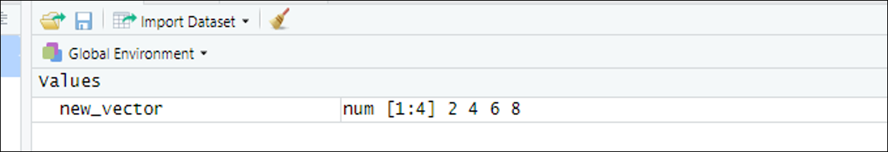
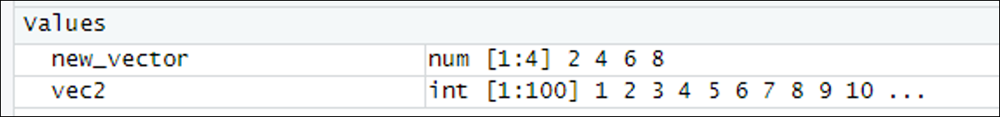
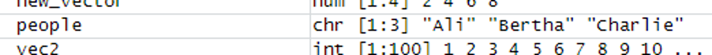

# Vectors 

::: {.info-box}
ℹ️ When working with R, two slogans are helpful: 1. Everything that exists in R is an object. 2. Everything that happens is a function call.

*John Chambers, one of the creators of the R programming language*.
:::

Objects in R come in various categories such as Vectors, Matrices, Data Frames and Lists. The simplest of these is vectors.

The word vector is used in different ways in different contexts. In R we can think of a vector "as a list of things in order", similar to the idea of a vector in mathematics.

## Defining a Numerical Vector

To define a new object in R we must give it a name. The name must be a continuous string of characters with no spaces. For example, if we wanted to define an object called "New Vector" sensible names would be

`NewVector` `new_vector` or `new.vector`.

Once we have chosen a name for our new object, we need to assign it a value. We do this with the assignment operator

```{r, eval=FALSE}
<- 
```

so if we type 

```{r, eval=FALSE}
new_vector <- 
```

we have so far told R that we are going to define a new object called `new_vector`. What we type next will be the definition of the object. To define a vector we need to use the letter c for "combine". So the command

```{r}
new_vector <- c(2,4,6,8)
```

would be read by R as "combine the numbers $2, 4, 6$ and $8$ into a vector and give them the label `new_vector`. Note that the elements of a vector must be separated by commas as shown.

When typing code it is important to be precise. A single character out of place might make the code unreadable for the computer. However, R will ignore spaces (unless they are in the middle of the name of the object). So R would read all of the following identically:

`new_vector<- c(2,4,6,8)`
`new_vector <- c( 2 , 4 , 6 , 8 )`
`new_vector <- c(2,4 ,   6 ,  8)`

Define an object called `new_vector` as above and look what happened in the "Environment" window (top right). You should see that the vector has appeared in the environment as follows:

<figure>
    <center>
        
        <figcaption style="text-align:center">
            Figure 1: The top right window (the "Environment") in <b><em>RStudio</b></em>, where`new_vector` is shown to be stored as a numerical vector.
        </figcaption>
    </center>
</figure>

"num" means that the vector has been stored by R as a numerical vector and R is reading the elements of the vector as numbers; `1:4` means that R has labelled the elements of the vector as first, second, third and fourth and the final part lists the elements of the vector.

We can now ask R to show us the vector by typing in the console window:

`new_vector`

```{r, eval=TRUE, echo=FALSE}
new_vector <- c(2,4,6,8)
```


R will then display our vector like so:

```{r, eval=TRUE, echo=TRUE}
new_vector
```

The `[1]` means that the first entry on that line is the first element of the vector.

We can also carry out calculations with our vector. Type the following:

<center>
   `new_vector + 2`
</center>

and R will add $2$ to each element of the vector like so:

```{r, eval=TRUE, echo=TRUE}
new_vector + 2
```

## Vectors using ":"

Type the following into the console

```{r} 
vec2 <- 1:100
vec2
```

The first line defines a new object called`vec2` and the second line asks R to display that object. You should see that`vec2` is a vector which consists of the whole numbers from $1$ to $100$. Looking in the environment will confirm that R has stored`vec2` as a numerical vector:

<figure>
    <center>
        
        <figcaption style="text-align:center">
            Figure 4: The "Environment" window in <b><em>RStudio</b></em> where`vec2` is shown to be stored as a numerical vector.
        </figcaption>
    </center>
</figure>

":" is a shortcut to create vectors like this. Experiment by typing the following commands into the console 

<center>
   `2:16`<br>
   `5.6:14`<br>
   `3.9:10`
</center>

## Character Vectors

A character vector is similar to a numerical vector but R will interpret the elements as words rather than numbers. This might be helpful if, for example, we have some data about different people and we want to include a list of their names. We define a character vector just like a numerical vector but we must put each element of the vector in inverted commas in the definition. For example:

<center>
   `people <- c("Ali”, “Bertha”, “Charlie”)`
</center>


defines a character vector called`people` which would store the names Ali, Bertha and Charlie. If you type this into the console you will see the new object appear in the environment like so:

<figure>
    <center>
        
        <figcaption style="text-align:center">
            Figure 5: The top right window (the "Environment") in <b><em>RStudio</b></em> where`people` is shown to be stored as a character vector.
        </figcaption>
    </center>
</figure>

"chr" shows that R is interpreting`people` as a character vector. Note that we did not need to tell R what sort of vector we were defining. Putting the elements in inverted commas was enough for R to know that our vector was a character vector.

The elements of a character vector are called **strings**.

In R " can often be replaced by ' without noticing the difference. The usual convention is to use ".

(For completeness: if, for some reason, you want to define a string which contains the character ", you should use ' at the beginning and the end of the definition.)

You will sometimes see vectors referred to as **atomic vectors**, which means that they can only contain one type of data. For example, a vector can contain either numeric or character values but not both in the same vector. If we try to define a vector with some numbers and some character strings, R will interpret the numbers as character strings.

## Exercise

1. Define a new vector called`vec3` which stores the numbers $3$, $4$, $7$, $9$, $12$.
2. Predict what the following code will do:
<center>
   `vec3 * 1:5`
</center>
Now type the code in the console and check your prediction.
3. Predict what the following code will do:
<center>
   `vec3 + 1:3`
</center>
Now type the code in the console and check your prediction.
4. Create a character vector`ice.cream` which contains the names of your favourite flavours of ice cream.  

(Note that in question $3$ we get an output along with the warning message. When R runs out of values in the second vector, it starts again with the first element.)

### Solutions

<details>
<summary>Solutions</summary>
Here is the code used to do the above exercise:

1.`&gt; vec3 &lt;- c(3,4,7,9,12)`  
<code style="color: blue;">&gt; vec3`  
<code>[1]  3  4  7  9 12`

2.`&gt; vec3*1:5`  
<code>[1]  3  8 21 36 60`  

3.`&gt; vec3+1:3`  
<code>[1]  4  6 10 10 14`  
<code style="color: red;">Warning message:`  
<code style="color: red;">In vec3 + 1:3 :`  
<code style="color: red;">  longer object length is not a multiple of shorter object length`  

4.`&gt; ice.cream &lt;- c("vanilla","coffee","strawberry")`  
<code style="color: blue;">&gt; ice.cream`  
<code>[1] "vanilla"   "coffee"   "strawberry"`  

Additional notes:  
2\.`vec3*1:5` multiplies the first element of`vec3` by $1$, the second element by $2$ and so on.  
3\.`vec3+1:3` adds $1$ to the first element of`vec3`, $2$ to the second element and $3$ to the third element. Then R "recycles" the numbers`1:3` so the fourth number in the output comes from the fourth element of`vec3` plus $1$ (i.e. $9+1=10$)
   
<\details>